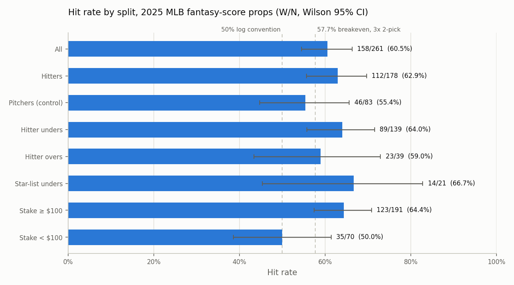
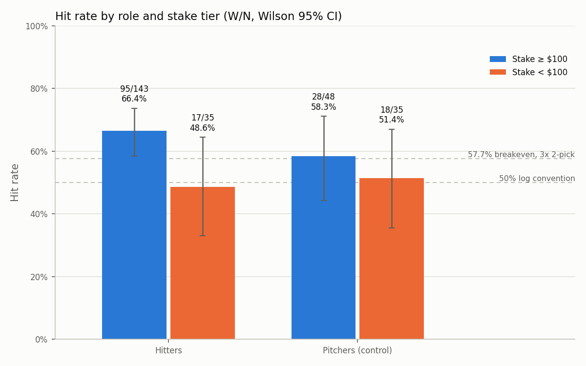

# trapbet

Are DFS fantasy-score lines (PrizePicks, Underdog) mispriced relative to a fair line rebuilt from
devigged sportsbook component props? This repo holds a 2025 MLB backtest of every fantasy-score prop
one person placed, plus the engines to rebuild fair lines for a live test. Personal research only;
no commercialization; nothing here is betting advice and no profit claim is made.

## Results

**Headline.** 158 of 261 MLB fantasy-score props hit (60.5%, Wilson 95% CI 54–66%), against a
57.7% per-leg breakeven on a 3x two-pick. The lower bound of the interval sits below breakeven.

**Hitters vs pitchers.** Hitters 112/178 (62.9%, CI 56–70%). Pitchers, the control group, 46/83
(55.4%, CI 45–66%). Hitter unders alone: 89/139 (64.0%).

**Stake tiers.** Props staked at $100 or more: 123/191 (64.4%, CI 57–71%). Under $100: 35/70
(50.0%, CI 39–61%). Within hitters the gap is 95/143 (66.4%) vs 17/35 (48.6%).



*Hit rate for each split with W/N on every bar and Wilson 95% intervals. Dashed lines mark the 50%
log convention and the 57.7% two-pick breakeven. Splits overlap; they are not independent samples.*



*Hitters and pitchers, each divided at a $100 real-money stake. The stake gap is large for hitters
(n = 143 and 35) and small for pitchers (n = 48 and 35).*

## What this does and doesn't show

- **Floor, not ceiling.** The sample is every bet placed, including knowingly low-edge action.
  It is not a curated subset.
- **Pitcher control.** Pitcher props sit closer to breakeven (46/83) than hitter props (112/178),
  consistent with the mechanism being tested: pitcher component markets are priced tighter, so the
  rebuilt fair line should disagree with the DFS line less often. One season is not proof of that.
- **Sizing tracked results.** The ≥ $100 tier beat the < $100 tier by 14 points overall
  (123/191 vs 35/70). Stakes were set before results were known, but the sample is small and the
  split was not pre-registered.
- **Signals not yet measured.** Of the seven trap signals, only S3 (star list) is filled for the
  backtest. S1 (recent streak) and S6 (opposing pitcher) await game-log reconstruction. S2, S4,
  S5 and S7 need line captures that do not exist for 2025.
- **The engine is unvalidated.** Its worked example is a regression test against a hand calculation
  that uses the same devig convention. Passing it shows the arithmetic is reproduced, not that the
  method prices lines correctly. That needs live lines and settled results.

Full table, Beta-binomial posteriors, monthly rates and every data flag: [RESULTS.md](RESULTS.md).

## How it works

1. Pull the component markets a book offers for the player (hits, H+R+RBI, walks, stolen bases, ...).
2. Devig each market and invert a Poisson tail to get an expected count per game (`fair_line.py`).
3. Fill any missing component from composite shares or season rates, then recombine with the
   platform's scoring weights into a fair fantasy score (`scoring.py`).
4. Simulate plate appearances to turn expected components into a score distribution and
   P(over / under the DFS line) (`simulate.py`).
5. Score the seven trap signals, flag candidates, and size with capped fractional Kelly
   (`trap.py`, `sizing.py`).

## Status (2026-11-02)

| Component | State |
|---|---|
| Backtest data (Experiment 1) | **Complete.** `data/bet_log.csv`: 261 MLB fantasy-score props from 2025, all dated, 158/261 hit (60.5%, Wilson 95% CI 54–66%). `data/high_stake_slips.csv`: 42 slips with ≥$100 stake. Both regenerate byte-identically from `build_log.py` / `build_high_stake.py`. |
| Analysis and figures | **Runs.** `analysis/beta_binomial.py` (Beta(5.77, 4.23) prior; P(p > 57.7%) = 0.82 for all 261 props, 0.35 for the 83-prop pitcher control) and `analysis/make_figures.py` write to `figures/`. |
| Engines (scoring, devig, fair_line, simulate, trap, sizing) | **Built and unit-tested; worked example reproduces the hand calculation; not yet run on live lines.** `trapbet/engines/`, 61 tests in `tests/`. All four scoring tables verified 2026-11-02. |
| S1 / S6 signal reconstruction from game logs | Not started. Next task. |
| Ingestion (DFS board + book odds snapshotter) | Not started. |
| Streamlit UI | Not started. |

Working rules and task order: [CLAUDE.md](CLAUDE.md).

## Rebuild

```text
pip install -r requirements.txt     # numpy, scipy, pandas, matplotlib, pytest
python build_log.py                  # data/mlbbets.txt + screenshot rows + data/undated_fills.csv -> data/bet_log.csv
python build_high_stake.py           # -> data/high_stake_slips.csv
python analysis/beta_binomial.py     # posterior table + figures/beta_binomial_posteriors.png
python analysis/make_figures.py      # figures/hit_rate_by_{split,stake,month}.png
python -m pytest -q                  # 61 tests
python examples/ohtani_example.py    # PrizePicks 9.5 from three book markets: fair FS 7.66, P(under) 0.68, 3 units (illustrative inputs)
```

## Assumptions

- **One-sided devig.** When a book offers only one side of a component market, the engine devigs it
  as fair = implied / (1 + hold) with an assumed hold (multiplicative). The additive alternative,
  fair = implied − hold / 2, gives a lower fair line (about 7.4 vs 7.66 in the Ohtani example) and
  is available as `devig_one_sided(..., method="additive")`. This choice matters only when one side
  of a market is available; with real two-way prices the conventions mostly cancel, and the live
  snapshotter will capture both sides.
- **The Ohtani example is a regression test, not a validation.** Its acceptance window was set from
  a hand calculation that uses the same devig convention.
- **Scoring tables** were verified on 2026-11-02 against the platform scoring pages. Both platforms
  have changed scoring before; re-check every table at the start of each season.
- **Breakeven convention.** `odds_or_payout` is 2.0 in the log (50/50 baseline). Real DFS breakeven
  on a 3x two-pick is 57.7% per leg. Every rate is reported against both, next to its n.
