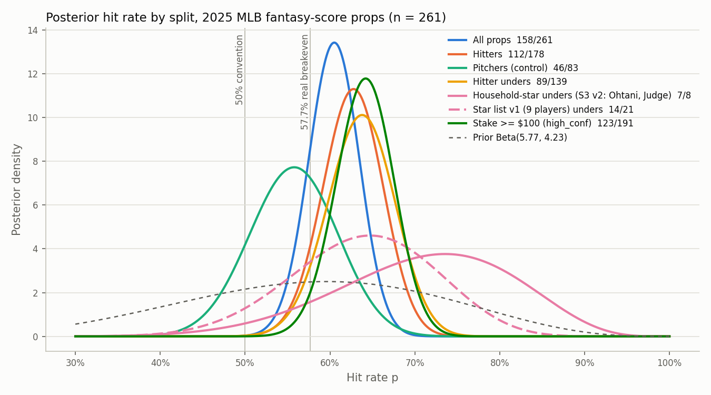
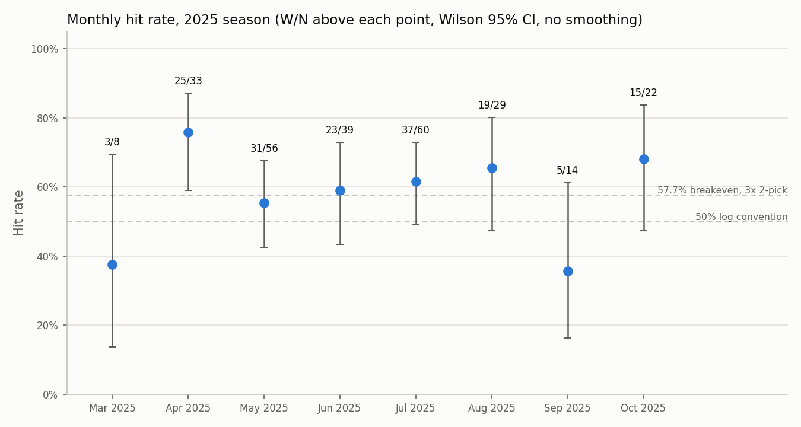

# Experiment 1 — 2025 MLB fantasy-score backtest (numbers frozen 2026-11-02, v2: all rows dated)

## What was measured
Every MLB fantasy-score prop I placed in the 2025 season, from my notes log cross-referenced against Pikkit
slip history (80 screenshots, 3/28–5/28) and my manual Pikkit lookup for the rest. **261 props, all dated
(3/27–10/16/2025). Stake tier known for all 261** (exact $ for 79 screenshot rows; over/under-$100 band for the rest).

### How I built the log
- One row per player per game-date. When a line moved within a day I kept one row; where the two results
  differed I counted the row as a win and tagged it `LINE_MOVE_FLIP` (2 rows; numbers below include them).
- Fantasy-score markets only, every platform, MLB only. Pitchers are included and tagged `role=pitcher`.
  I excluded partial-game (1–3 inning) fantasy props and all tennis, NBA and soccer legs.
- I dropped voided legs, not the whole slip.
- `odds_or_payout` is 2.0 for every row by convention (a 50/50 baseline). Real DFS breakeven is 57.7% per leg
  on a 3x 2-pick, so I report both.
- `high_conf` = 1 when my total real-money stake on that prop that day was ≥ $100 (free bets count as $0).
- Where my notes and a screenshot disagreed, the notes decide the result and the screenshot decides the
  date, stake and platform.
- Rows tagged `BOTH_SIDES` and `DATE_TYPO?` are flagged, not resolved.
- Platform codes: prizepicks, underdog, app_A ("Fantasy Points — Full Game"), app_B (fantasy points shown
  with American odds). I still need to map app_A/app_B to ParlayPlay/Boom.

| Slice | W/N | Rate | Wilson 95% CI |
|---|---|---|---|
| All props | 158/261 | 60.5% | 54%–66% |
| Hitters | 112/178 | 62.9% | 56%–70% |
| Pitchers (control) | 46/83 | 55.4% | 45%–66% |
| Hitter unders | 89/139 | 64.0% | 56%–72% |
| Hitter overs | 23/39 | 59.0% | — |
| Household stars (S3 v2: Ohtani, Judge) — unders | 7/8 | 87.5% | 53%–98% |
| Star list v1 (9 players) — unders | 14/21 | 66.7% | 45%–83% |
| Stake ≥ $100 | 123/191 | 64.4% | 57%–71% |
| Stake < $100 | 35/70 | 50.0% | 39%–61% |
| Hitters, ≥$100 vs <$100 | 95/143 vs 17/35 | 66.4% vs 48.6% | — |
| Hitter unders, ≥$100 vs <$100 | 75/110 vs 14/29 | 68.2% vs 48.3% | — |
| Pitchers, ≥$100 vs <$100 | 28/48 vs 18/35 | 58.3% vs 51.4% | — |

Breakeven: 50% by the 50/50 convention used in the log; 57.7% per leg at real 3x 2-pick payouts.

*Beta-binomial posteriors with a Beta(5.77, 4.23) prior centred on the 57.7% breakeven (10 pseudo-observations). P(p > 57.7%): all 261 props 0.82; hitters (n = 178) 0.92; pitchers (n = 83) 0.35; hitter unders (n = 139) 0.93; household-star unders (S3 v2, n = 8) 0.89; star list v1 unders (n = 21, dashed) 0.76; stake ≥ $100 (n = 191) 0.97. Splits are nested, not independent. Regenerate with `python analysis/beta_binomial.py`.*

By month: 03/25 3/8 (38%) · 04/25 25/33 (76%) · 05/25 31/56 (55%) · 06/25 23/39 (59%) · 07/25 37/60 (62%) · 08/25 19/29 (66%) · 09/25 5/14 (36%) · 10/25 15/22 (68%).

*Monthly hit rate with W/N above each point and Wilson 95% intervals; no smoothing. Three months have n < 15 and intervals wider than 40 points. Regenerate with `python analysis/make_figures.py`.*

## Definition changes
- **S3 star list, 2026-11-02.** Old (v1, 2026-10-29): Ohtani, Judge, Soto, Harper, Betts, Acuña, Guerrero Jr.,
  Tatís Jr., Ramírez. New (v2): Ohtani and Judge only. Reason: the mechanism I am testing is casual-bettor
  popularity inflating DFS lines, and casual bettors know household names, not baseball-fan names; the v1 list
  mixed the two. This change was made after the backtest results were known; the v1 result is kept here so the
  effect of the redefinition is visible. Under v2 the star split is 10 props (8 unders, 7 hit); under v1 it was
  29 props (21 unders, 14 hit). Both lists are in `trapbet/engines/trap.py` (`STARS`, `STARS_V1`).

## High-stake slips (slip-level, not deduped; screenshot window only)
42 slips with visible stake ≥ $100. Fantasy legs 43/62 (69.4%). Only 15 slips won: on 8 of 20 mixed
slips every fantasy leg hit and a non-fantasy partner lost ($1,417 of stake).

## Interpretation

> **PLACEHOLDER — to be written.** The bullets below are my working notes, not final text.

- Floor, not ceiling: the sample is every bet I placed, including action I knew was low-edge.
- Pitcher control fits the mechanism (component props tightly priced → small relative gap).
- Sizing: conviction tracked results — 18-point gap on hitters, ~7 on pitchers; low-stake hitter unders ran at a coin flip.
- Memory check: I remembered "~90% on star unders"; it measured 14/21 on the v1 list and 7/8 on the v2 household
  list; Judge 6/7, Ohtani 4/4 across all their props (n small; shrink).

## What could NOT be measured historically
S2 popularity, S4 cross-platform gap, S5 fair-line gap, S7 reverse movement — no line captures exist
for 2025. S1 and S6 pending game-log reconstruction (now possible for all 261 rows). No closing lines.
No ROI (exact stakes for 79 rows only).

## Known data flags
LINE_MOVE_FLIP ×2 (Eflin 4/2, Lowe 5/27); BOTH_SIDES ×2 (Schwellenbach 5/8, A. Garcia 5/23);
DATE_TYPO? ×1 (Bo Naylor 9/17/23 → 2025); stake unreadable on 4 slips (excluded from slip table);
notes duplicates for Judge & Langford 7/13 kept deliberately (I sometimes mis-dated entries); S3_star column
reflects the v2 definition (see Definition changes), v1 is derived from names at analysis time; 7 notes rows
merged into screenshot rows as verifiably the same bet (Lugo 4/25, Gilbert 4/25, Judge 5/4 & 5/5, Schwellenbach 5/8, Tatis 5/10, Ramírez 5/11).
